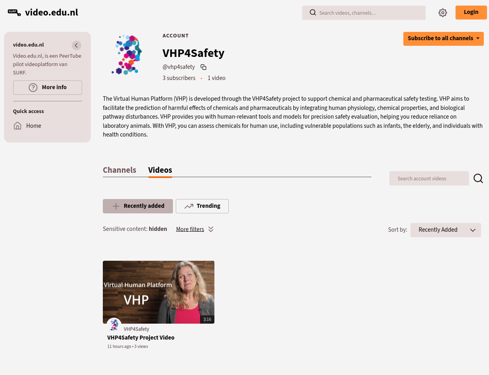
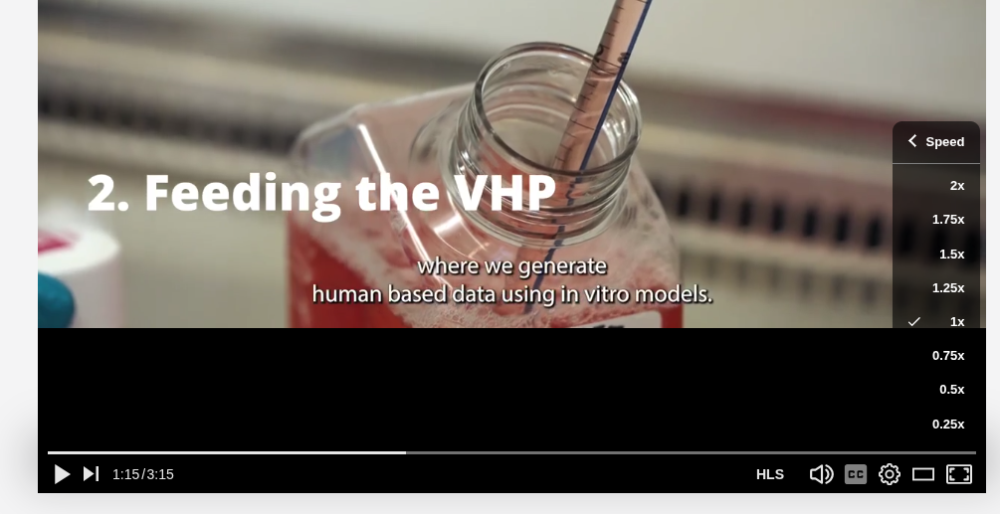
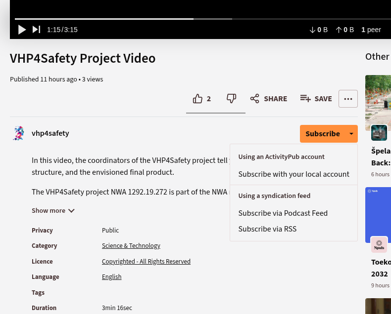

# VHP4Safety videos on SURF's PeerTube instance

PeerTube is open source software for sharing videos, like project introductions, webinars, and 
demos, and screenshots explaining how to use software. The Dutch SURF overs an PeerTube
instance for use by Dutch higher education. VHP4Safety uses this platform to share videos.
This document describes how you can watch these videos, but also how you can receive
alerts when new videos show up.

## Watching videos

The simplest way to watch videos is to just visit our VHP4Safety channel at [https://video.edu.nl/a/vhp4safety/videos](https://video.edu.nl/a/vhp4safety/videos).
That website looks something like this:

You do not need an account and you do not need to accept any cookies that may track your
online behavior. You can click a video and it will automatically start playing the video. You can
pause or stop the video, change the speed, and customize your experience with various other
common features you are used to:

## Subscribing to the VHP4Safety videos

If you like to get alerted about new videos on our PeerTube channel, there are two options.

### Following via the fediverse

If you have a fediverse account, e.g. Mastodon account via SURF's social.edu.nl platform,
then you can just subscribe via the Subscribe button below the video and select
`Subscribe with your local account`:

Maybe easier, however, is to just follow directly from
your fediverse client software, search for VHP4Safety profiles, and select the
`@vhp4safety@video.edu.nl` account. In both cases, the next time our project posts a video,
you get a message via the fediverse.

### Following via a podcast or RSS feed

If you prefer to have the videos show up in your podcast application or in your newsfeed
application (for example [Feedly](https://feedly.com/)), then the PeerTube software provide two feeds:

* [this podcast feed](https://video.edu.nl/feeds/podcast/videos.xml?videoChannelId=901)
* [this RSS feed](https://video.edu.nl/feeds/videos.xml?videoChannelId=901)

## Final notes

We welcome all videos related to VHP4Safety. If your project video can be added too, please
[contact us](https://platform.vhp4safety.nl/#contact-section).
